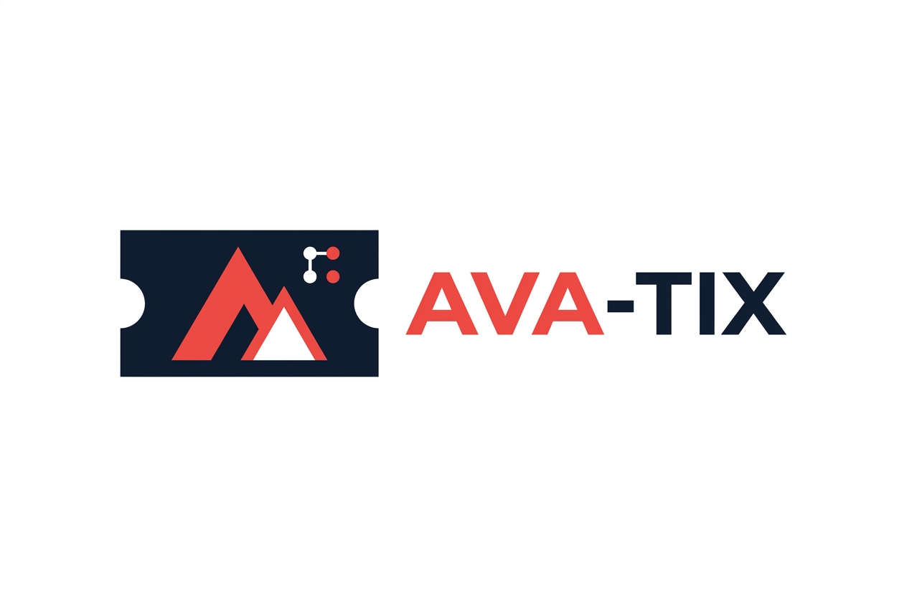

<p align="center">
  
</p>

<h1 align="center">AVA-TIX — Nền tảng Phân phối &amp; Quản trị Vé Sự kiện trên Avalanche</h1>

<p align="center">
  <b>Đề án dự thi UniHack Avalanche 2026</b><br/>
  Chống vé giả bằng QR động 20 giây · Chống phe vé với trần giá bán lại 110% · Bảo chứng giao dịch trên Avalanche Fuji C-Chain
</p>

<p align="center">
  <a href="https://demoavatix.onrender.com"><b>Live Demo (Render)</b></a> ·
  <a href="https://testnet.snowtrace.io/address/0xD99D4e77Be798b855a2BD8de4aE11D86DC251118"><b>AvaTicket (Snowtrace)</b></a> ·
  <a href="https://testnet.snowtrace.io/address/0x4D07bbcB314A492FDFEB94eB12fbF0f1A04541Df"><b>TicketMarketplace (Snowtrace)</b></a>
</p>

---

## 1. Tổng quan & Bài toán giải quyết

Thị trường vé sự kiện tại Việt Nam thường gặp 4 vấn đề lớn: **lừa đảo vé giả / chụp ảnh màn hình QR**, **phe vé đầu cơ đẩy giá gấp nhiều lần**, **gom vé hàng loạt bằng tài khoản ảo**, và **rủi ro mất tiền khi sự kiện bị hủy**.

**AVA-TIX** giải quyết trực tiếp các bài toán này bằng kiến trúc **Hybrid Web2.5 / Web3 (Relayer Gasless)** kết hợp cơ sở dữ liệu tốc độ cao (**SQLite / Turso Cloud**) và Smart Contract trên **Avalanche Fuji C-Chain**:

| Vấn đề | Giải pháp của AVA-TIX |
|---|---|
| **Vé giả & Ảnh chụp màn hình** | Mã QR động tự xoay mỗi **20 giây** ký HMAC-SHA256 gắn với chủ sở hữu hiện tại; chỉ mở được sau khi nhập **mã PIN bảo mật 6 số**. Ảnh chụp màn hình hoặc vé đã chuyển chủ bị từ chối ngay tại cổng. |
| **Phe vé thổi giá** | Chợ sang nhượng chính thức khóa **trần giá bán lại tối đa 110% giá gốc**, kiểm tra đồng thời ở Backend và trong Smart Contract `TicketMarketplace.sol`. |
| **Gom vé bằng nick ảo** | Ban tổ chức cài đặt giới hạn số vé/tài khoản (`max_per_user`, hỗ trợ số lượng tùy chỉnh), kết hợp ràng buộc **1 Email + 1 Số điện thoại duy nhất / tài khoản** ở cả tầng API và SQLite Trigger. |
| **Rào cản ví Web3 & phí gas** | Người dùng đăng nhập bằng tài khoản thông thường, hệ thống tự sinh địa chỉ ví EVM xác định và **Relayer** đứng ra ký + trả gas AVAX thay cho người dùng (Gasless UX). |
| **Rủi ro hủy show & gian lận** | Khi Ban tổ chức hủy show (hoặc Admin đình chỉ show vi phạm), hệ thống tự động **hoàn 100% tiền vé** về ví khán giả và vô hiệu hóa toàn bộ vé. |

---

## 2. Minh chứng On-chain (Avalanche Fuji Testnet)

* **Mạng:** Avalanche Fuji C-Chain (`Chain ID: 43113`)
* **RPC:** `https://api.avax-test.network/ext/bc/C/rpc`

| Thành phần | Địa chỉ trên Fuji Testnet | Snowtrace Explorer |
|---|---|---|
| **AvaTicket** (Quản lý vé & check-in) | `0xD99D4e77Be798b855a2BD8de4aE11D86DC251118` | [Xem hợp đồng ↗](https://testnet.snowtrace.io/address/0xD99D4e77Be798b855a2BD8de4aE11D86DC251118) |
| **TicketMarketplace** (Sơ cấp, sang nhượng giá trần, soát vé) | `0x4D07bbcB314A492FDFEB94eB12fbF0f1A04541Df` | [Xem hợp đồng ↗](https://testnet.snowtrace.io/address/0x4D07bbcB314A492FDFEB94eB12fbF0f1A04541Df) |
| **Ví Relayer / Deployer** | `0x43bBc352057D887C503b1a84a8571f3d4B5413c2` | [Xem giao dịch ↗](https://testnet.snowtrace.io/address/0x43bBc352057D887C503b1a84a8571f3d4B5413c2) |

> **Ghi chú kiến trúc Hybrid:** Số dư VNĐ, nạp tiền (MoMo/Ngân hàng/VNPAY/VietQR) và đối soát hoàn tiền được quản lý trên sổ cái DB (SQLite/Turso); các nghiệp vụ cốt lõi của vé (phát hành vé, niêm yết bán lại có giá trần +10%, chuyển quyền sở hữu khi bán lại, và check-in theo khung thời gian QR) được ghi nhận on-chain qua Relayer và trả về `txHash` liên kết trực tiếp tới Snowtrace.

---

## 3. Tính năng chính theo 3 vai trò

### 👤 Khách hàng (`/customer.html`)
* **Khám phá & Mua vé:** Tìm kiếm sự kiện, xem chi tiết, kiểm tra giới hạn vé/tài khoản, xác nhận điều khoản (popup tại chỗ) và thanh toán qua số dư ví kèm **OTP Email**.
* **Vé của tôi & QR động 20 giây:** Xem danh sách vé điện tử (E-Ticket), mở mã QR động sau khi xác thực **PIN 6 số** (quyền mở khóa có hiệu lực 2 phút cho từng vé), xem minh chứng `txHash` trên Snowtrace.
* **Chợ sang nhượng (Resale Market):** Đăng bán lại vé chưa sử dụng với giá trần ≤ 110% giá gốc (phí sàn 5%), hủy niêm yết hoặc mua lại vé từ khán giả khác.
* **Tài khoản & Lịch sử:** Chuyển giao diện **Sáng / Tối**, cắt và lưu ảnh đại diện 1:1 (WebP 512×512), xem **Lịch sử On-chain** hiển thị theo múi giờ Việt Nam (`UTC+7`).

### 🎪 Ban tổ chức (`/organizer.html`)
* **Dashboard thống kê & Biểu đồ doanh thu:**
  * Phân loại tự động 3 nhóm sự kiện: **Sắp diễn ra (Đang bán vé)**, **Đã diễn ra**, **Đã hủy**.
  * **Biểu đồ đa đường theo ngày (SVG)** so sánh đồng thời tất cả các show (gạt giữa Doanh thu 95% và Số vé bán, lọc 7/14/30 ngày/Tất cả, bật/tắt từng show trên legend, rê chuột/chạm xem cả 2 chỉ số cùng lúc).
  * **Biểu đồ chi tiết từng show** kết hợp cột số vé bán và đường xu hướng doanh thu.
* **Quản trị sự kiện:** Tạo show mới (hỗ trợ tải ảnh poster từ thiết bị hoặc chọn mẫu có sẵn, cài đặt giới hạn vé/tài khoản linh hoạt), đổi ảnh đại diện show, **Hủy show hoàn tiền 100%** (chỉ áp dụng cho show chưa diễn ra).
* **Soát vé tại cổng (Check-in):** Tích hợp **Camera QR Scanner** (`html5-qrcode`) quét trực tiếp từ điện thoại/webcam kèm âm thanh phản hồi, hoặc dán mã thủ công; xác thực chữ ký QR 20 giây và ghi nhận trạng thái đã check-in lên Smart Contract.

### 🛡️ Quản trị viên (`/admin.html`)
* **Dashboard vận hành toàn sàn:** Tổng số Khách hàng / Ban tổ chức, tổng số vé đã bán / check-in / hoàn tiền, **tổng phí sàn 5% AVA-TIX thu được** (sơ cấp & thứ cấp), và **số dư gas AVAX của ví Relayer** (cảnh báo khi < 0.05 AVAX).
* **Quản lý Users & Duyệt Ban tổ chức:** Ban tổ chức mới đăng ký bắt đầu ở trạng thái `Chờ duyệt` cho tới khi Admin duyệt CCCD; hỗ trợ duyệt, khóa hoặc mở khóa tài khoản (ngắt phiên ngay lập tức khi khóa). Toàn bộ dữ liệu nhạy cảm (`Email`, `SĐT`, `CCCD`, `Số tài khoản`) được **che trực tiếp từ API** (`pe***@gmail.com`, `090****888`, `********3456`).
* **Kiểm duyệt sự kiện toàn hệ thống:** Theo dõi toàn bộ show của mọi BTC, kèm nút **🚫 Hủy & Hoàn tiền 100%** để đình chỉ khẩn cấp các show vi phạm đang mở bán (tự động khóa nút hủy với các show đã diễn ra).
* **An toàn đăng nhập:** Không có nút 1-click Admin công khai trên `/login.html`; tài khoản Admin chỉ được khởi tạo khi khai báo `ADMIN_USER` và `ADMIN_PASS` trong biến môi trường.

---

## 4. Cơ chế Bảo mật & Quản lý Tài khoản

* **Phiên đăng nhập kép (Hybrid Dual-Session):** Cho phép đăng nhập tối đa **1 phiên Máy tính (PC)** và **1 phiên Điện thoại (Mobile)** song song. Nếu thiết bị thứ 2 cùng loại đăng nhập, phiên cũ tự động bị đăng xuất để chống chia sẻ tài khoản xem vé.
* **Mã bảo mật PIN 6 số (`pin-security.js`):**
  * Người đăng ký mới tự chọn và xác nhận PIN 6 số (băm bằng `scrypt` với salt riêng). Tài khoản cũ chưa có PIN vẫn đăng nhập bình thường và có thể thiết lập PIN trong *Tài khoản* hoặc khi mở QR lần đầu.
  * Đăng nhập chỉ cần tên đăng nhập + mật khẩu. PIN dùng để mở khóa **mã QR vé** (hiệu lực 2 phút), mở khóa **đổi mật khẩu** (hiệu lực 10 phút qua header `X-Password-Unlock`) và **đổi chính mã PIN**.
  * Nhập sai PIN 5 lần sẽ khóa xác thực PIN trong 5 phút. Có luồng khôi phục PIN bằng mật khẩu + OTP Email.
* **Định danh duy nhất (`1 Email + 1 SĐT = 1 Tài khoản`):** Chuẩn hóa email (bỏ khoảng trắng, chữ thường) và SĐT ở tầng API kèm index & SQLite Trigger chống đăng ký trùng đồng thời (HTTP `409`), vẫn bảo toàn tài khoản cũ nếu DB cũ đã có dữ liệu trùng.
* **Ảnh đại diện an toàn (`avatar.js`, `avatar-worker.js`):** Cắt khung vuông 1:1 ngay trên trình duyệt, hỗ trợ thêm chuyển đổi `HEIC/HEIF` và `TIFF` ở server (giới hạn 8 MiB / 40 megapixel), chuẩn hóa lưu dạng **WebP tĩnh 512×512** đã loại bỏ metadata và không bao giờ lưu SVG thực thi.
* **Giao diện Sáng / Tối & Mobile Responsive:** Chuyển đổi theme mượt mà (`theme.js` + `dark.css`) ghi nhớ trên trình duyệt, hỗ trợ đầy đủ bố cục mobile (card view, bottom-sheet modal, swipe tabs).

---

## 5. Kiến trúc & Cấu trúc thư mục

* **Backend:** Node.js 22 LTS, Express 4, `ethers` v6, `qrcode`, `nodemailer`, `sharp`, `heic-decode`
* **Database:** Dual-mode — `better-sqlite3` (SQLite cục bộ `avatix.db`) và `@libsql/client` (Turso Cloud trên production)
* **Smart Contracts:** Solidity `0.8.20`, Hardhat (`@nomicfoundation/hardhat-toolbox`)
* **Frontend:** Vanilla JavaScript, HTML5, CSS3 (Light/Dark theme, SVG Charts), `html5-qrcode`

```text
avatix/
├── server.js                  # Express API, Auth phiên kép, OTP, Mua/Bán lại/Soát vé, Admin API
├── db.js                      # Dual-mode DB adapter (SQLite local / Turso cloud) & auto-migration
├── blockchain.js              # Tích hợp Avalanche Fuji (Relayer gasless, hàng đợi nonce, Snowtrace URL)
├── mailer.js                  # Gửi OTP qua Brevo HTTPS API (ưu tiên cho Render Free) hoặc SMTP
├── pin-security.js            # Quản lý mã PIN 6 số, khóa thử sai và cấp token mở khóa ngắn hạn
├── avatar.js                  # Chuẩn hóa ảnh đại diện WebP 512x512 (sharp / heic-decode)
├── avatar-worker.js           # Worker thread xử lý chuyển đổi ảnh nặng
├── contracts/
│   ├── AvaTicket.sol          # Hợp đồng quản lý vé & trạng thái check-in theo QR window
│   └── TicketMarketplace.sol  # Hợp đồng bán sơ cấp, chợ thứ cấp trần +10% và check-in
├── scripts/
│   ├── deploy.js              # Deploy 2 contract lên Hardhat Local hoặc Avalanche Fuji
│   └── gen-wallet.js          # Tạo ví EVM mới cho Deployer/Relayer
├── public/
│   ├── login.html             # Đăng nhập, đăng ký, xác thực email, khôi phục mật khẩu/PIN
│   ├── customer.html          # Giao diện Khách hàng
│   ├── organizer.html         # Giao diện Ban tổ chức (biểu đồ + camera soát vé)
│   ├── admin.html             # Giao diện Quản trị viên
│   ├── app.js                 # Logic dùng chung (header, modal, QR, lịch sử, avatar cropper)
│   ├── security-ui.js         # UI bảo mật PIN & tài khoản
│   ├── theme.js               # Quản lý giao diện Sáng / Tối
│   ├── style.css / profile.css / dark.css
│   ├── logo.jpg / logo-dark.jpg / icon.jpg / logo-icon.svg  # Bộ nhận diện thương hiệu AVA-TIX
│   └── terms.html             # Điều khoản & Chính sách
├── test/
│   └── AvaTicket.test.js      # Test Smart Contracts (Hardhat)
├── tests/
│   ├── backend.test.js        # Test API avatar, OTP, DEMO_OTP_BYPASS, Admin & hủy show
│   ├── mailer.test.js         # Test Brevo HTTPS API & SMTP (không lộ OTP/bí mật)
│   ├── security-pin.test.js   # Test PIN 6 số, quyền mở QR & đổi mật khẩu
│   └── account-identity.test.js # Test ràng buộc 1 email + 1 SĐT duy nhất
└── docs/
    └── AVATIX_PROJECT_BLUEPRINT.md
```

---

## 6. Cài đặt & Chạy cục bộ

Khuyến nghị **Node.js 22 LTS**.

```bash
git clone https://github.com/AVA-TIX/AVATIX.git
cd AVATIX
npm ci
cp .env.example .env
npm start
```

Mở trình duyệt tại `http://localhost:3000`. Khi chưa cấu hình Turso, ứng dụng tự tạo `avatix.db`, tự migrate schema và seed sẵn 2 tài khoản mẫu (`demo_customer` / `demo_organizer`, mật khẩu `Demo@2025`) cùng 3 sự kiện mẫu.

### Bảng biến môi trường (`.env` / Render Environment)

| Nhóm | Biến môi trường | Mô tả |
|---|---|---|
| **Cốt lõi** | `SECRET` | Chuỗi bí mật ký cookie phiên, QR động, hash OTP và sinh ví EVM. **Bắt buộc đổi chuỗi ngẫu nhiên mạnh khi deploy.** |
| | `PORT` | Cổng chạy máy chủ (mặc định `3000`). |
| **Database** | `TURSO_DATABASE_URL`, `TURSO_AUTH_TOKEN` | Kết nối Turso Cloud trên production. Bỏ trống khi chạy local để dùng SQLite `avatix.db`. |
| **Blockchain (Fuji)** | `RPC_URL`, `CHAIN_ID` | `https://api.avax-test.network/ext/bc/C/rpc` và `43113`. |
| | `AVA_TICKET_ADDRESS`, `MARKETPLACE_ADDRESS` | Địa chỉ 2 hợp đồng sau khi deploy. |
| | `RELAYER_KEY` | Private key ví Relayer có AVAX testnet để ký & trả gas cho người dùng. |
| **Email OTP (Cách 1 — Khuyên dùng trên Render Free)** | `BREVO_API_KEY`, `MAIL_FROM_EMAIL`, `MAIL_FROM_NAME` | Gửi email thật qua **Brevo HTTPS API** (cổng `443`, không bị Render Free chặn). Dùng key **`xkeysib-...`** (tab *API Keys*, không phải *SMTP Key*) và xác minh `MAIL_FROM_EMAIL` trong mục *Senders* của Brevo. |
| **Email OTP (Cách 2 — Local / Paid Server)** | `SMTP_HOST`, `SMTP_PORT`, `SMTP_SECURE`, `SMTP_USER`, `SMTP_PASS`, `SMTP_FROM` | Gửi qua Nodemailer SMTP (ví dụ Gmail App Password cổng `465`/`587`). Lưu ý: Render Free chặn cổng SMTP outbound `25/465/587`. |
| **Demo Giám khảo** | `DEMO_OTP_BYPASS` | Mặc định `0` (tắt). Đặt `1` trên môi trường demo để 2 tài khoản mẫu (`demo_customer` / `demo_organizer`) mua vé 1-chạm không cần đọc hộp thư `@avatix.vn`; tài khoản người dùng thật vẫn bắt buộc OTP email. |
| **Quản trị (Admin)** | `ADMIN_USER`, `ADMIN_PASS`, `ADMIN_EMAIL` | Khai báo trên server để khởi tạo tài khoản đăng nhập vào `/admin.html`. Không lưu mật khẩu Admin trong Git. |

---

## 7. Deploy Smart Contract & Kiểm thử

### Chạy kiểm thử tự động

```bash
# Kiểm thử Smart Contracts (10 test cases)
npm run test:contracts

# Kiểm thử Backend, Mailer, PIN và Định danh tài khoản
npm run test:app
node --test tests/security-pin.test.js tests/account-identity.test.js
```

### Chạy thử với Hardhat Local Node (không cần AVAX faucet)

```bash
# Terminal 1: Khởi động EVM local node
npm run chain

# Terminal 2: Deploy contract (tự cập nhật .env) và chạy server
npm run deploy:local
npm start
```

### Deploy lên Avalanche Fuji Testnet (`Chain ID: 43113`)

1. Tạo ví Deployer (nếu chưa có): `node scripts/gen-wallet.js` và điền `DEPLOYER_KEY`, `DEPLOYER_ADDRESS` vào `.env`.
2. Nhận AVAX Testnet miễn phí tại [Avalanche Builder Hub Faucet](https://build.avax.network/console/primary-network/faucet) hoặc [Core Faucet](https://core.app/tools/testnet-faucet/).
3. Chạy lệnh deploy:
   ```bash
   npm run deploy:fuji
   ```
4. Cập nhật 5 biến (`RPC_URL`, `CHAIN_ID=43113`, `AVA_TICKET_ADDRESS`, `MARKETPLACE_ADDRESS`, `RELAYER_KEY`) lên Render Environment Variables.

---

## 8. Bộ nhận diện thương hiệu

Các file logo sẵn sàng cho Website, GitHub và Slide Pitch Deck được lưu trong `public/`:
* Logo ngang nền sáng: [public/logo.jpg](public/logo.jpg)
* Logo ngang nền tối: [public/logo-dark.jpg](public/logo-dark.jpg)
* Icon vuông 1:1 (App Icon / Avatar): [public/icon.jpg](public/icon.jpg)
* Vector Favicon & Header Icon: [public/logo-icon.svg](public/logo-icon.svg)

---

## 9. Lưu ý vận hành

* Thanh toán nạp tiền VNĐ (`MoMo / Ngân hàng / VNPAY / VietQR`) đang ở chế độ mô phỏng phục vụ trải nghiệm 1-chạm; không sử dụng khóa ví testnet hoặc `SECRET` mặc định cho môi trường Mainnet thực tế.
* Luôn giữ `.env`, API Key (Brevo/SMTP), `RELAYER_KEY` và `ADMIN_PASS` ngoài Git (`.env` đã nằm trong `.gitignore`).
